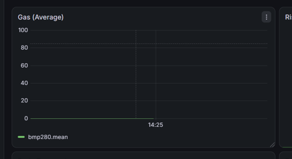
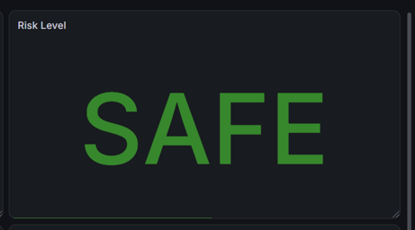
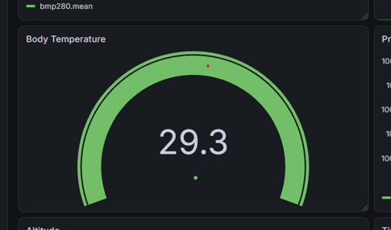
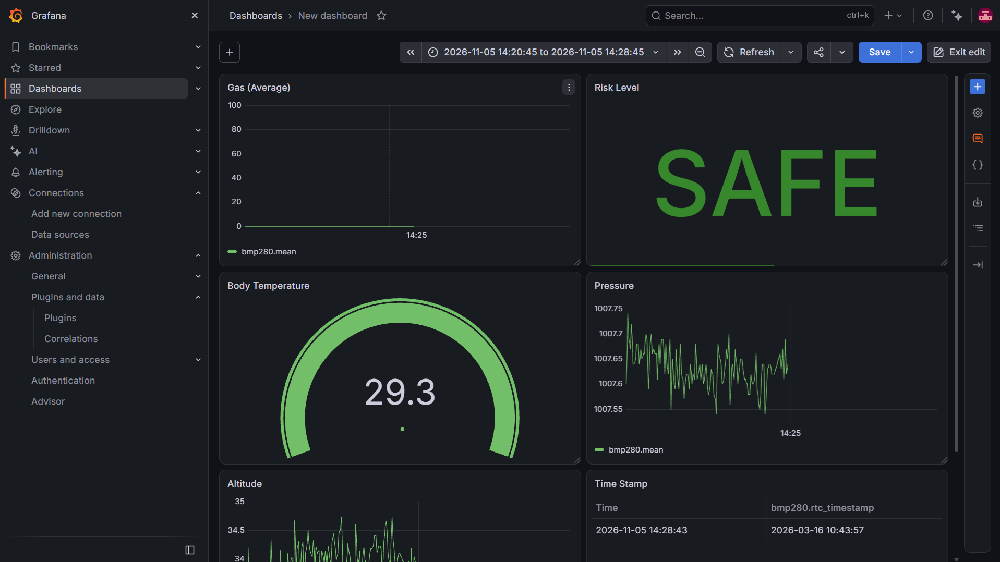

# Lab 4 – Multi-Sensor IoT Monitoring

ESP32 (MicroPython) reads four sensors, applies edge logic, and publishes over MQTT to Node-RED, which stores data in InfluxDB for Grafana.
Detailed Lab instructions in /img/LAB4_Multi_Sensor_IoT_Grafana.pdf

## Data Flow


## Wiring

| Sensor | Measures | SDA | SCL |
|---|---|---|---|
| BMP280 | Pressure, altitude | GPIO21 | GPIO22 |
| DS3231 | Timestamp | GPIO18 | GPIO19 |
| MLX90614 | Body temperature | GPIO25 | GPIO26 |

- I2C modules: VCC to 3V3, GND to GND.
- MQ-5: VCC to VIN (5V), GND to GND, AO through a 10k/20k divider to GPIO34.

Diagram: `docs/wiring-diagram.png`

## Edge logic

- Gas: 12-bit ADC, 5-sample moving average
- Risk: below 2100 SAFE (0), 2100–2599 WARNING (1), 2600 and above DANGER (2)
- Fever: `fever_flag = 1` if body temp ≥ 32.5 °C
- Pressure (hPa) and altitude (m) sent as read
- Timestamp from DS3231


Packet (topic `/aupp/lab4`, every 2 s):

```json
{"timestamp":"2026-11-05 14:30:00","gas_raw":1850,"gas_avg":1832.4,
 "risk_level":"SAFE","risk_code":0,"body_temp":33.1,"fever_flag":1,
 "pressure":1007.65,"altitude":33.83}
```

## Setup

1. **ESP32:** copy `src/main.py` and `lib/bmp280.py` to the board. Put Wi-Fi details, Client ID, etc... in `main.py`. Set the RTC once with `rtc.set_datetime(...)`, then comment it out.
2. **Node-RED:** import `node-red/flows.json`. MQTT node output: parsed JSON, topic `/aupp/lab4`. InfluxDB node: `127.0.0.1:8086`, database `lab4_iot`, measurement `bmp280`. Deploy. 
3. **InfluxDB:** `CREATE DATABASE lab4_iot`
4. **Grafana:** add InfluxDB data source (InfluxQL, database `lab4_iot`) and import `grafana/dashboard.json`.

## Grafana panels

| Panel | Type | Field |
|---|---|---|
| Gas average | Time series | `gas_avg` |
| Risk level | Stat (0/1/2 mapped to SAFE/WARNING/DANGER) | `risk_code` |
| Body temperature | Gauge | `body_temp` |
| Pressure | Time series | `pressure` |
| Altitude | Time series | `altitude` |
| DS3231 timestamp | Table | `rtc_timestamp` |

## Evidence

| Task | Screenshot |
|---|---|
| 1. Gas moving average |  |
| 2. Risk states |  |
| 3. Body Temperature |  |
| 4. Grafana dashboard |  |


## Troubleshooting

- **MQTT "connecting":** port 1883 may be blocked. Try another broker or a phone hotspot.
- **`gas_raw` always 0:** check the MQ-5 power, ground, and divider.
- **Grafana "No data":** use a relative time range and check the data source database.
- **Timestamp panel empty:** use a Table panel, not Stat.

## Notes

- Public brokers are open: use a unique topic.
- Never commit Wi-Fi credentials.
- [Demo]()
